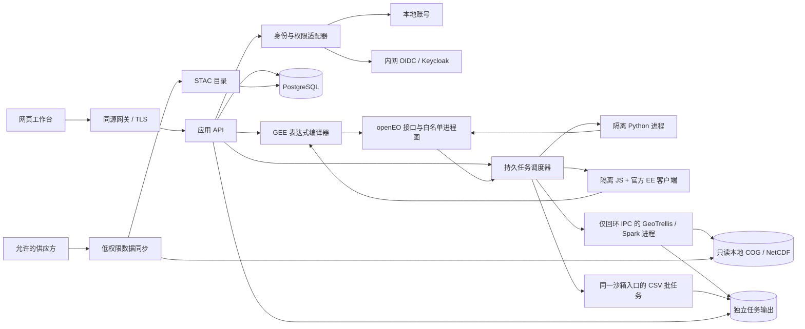

# 私有遥感工作台架构

状态：实施基线 v2，2026-10-21。当前运行配置改为 macOS 原生；旧容器验收仅属历史证据。面向个人科研和小团队，先在本机 macOS ARM64 验证，再具备向受控服务器部署的能力。本文规定目标边界和验收；不代表所有组件已完成或已通过生产验收。

## 1. 目标与约束

- 尽量保留常用 GEE JavaScript 项目的写法，通过官方客户端生成表达式，由本地兼容层转换为受控计算；Python 与 openEO 流程图继续可用。
- 数据、脚本、账号、结果和日志可在内网保存；已有数据支持离线检索、计算、预览和导出。构建及显式数据同步允许受控外网连接。
- 架构采用模块化单体控制面、独立沙箱进程及明确协议，不为模块化而把每个业务对象拆成微服务。计算、同步、身份服务保留独立部署边界。
- 先按 5 名用户、1 个重任务并行规划；脚本并发、资源、队列和磁盘预算由配置管理。吞吐能力通过测量决定。
- macOS ARM64 为当前执行平台；Linux 和 amd64 需要独立验收。原生 JNI/Java/Scala/GDAL 组合与文件摘要有清单。
- 无法承诺整个 GEE 全球数据目录、私有资产和所有服务端算法自动可用；不支持的请求明确失败，不伪造数据或静默忽略参数。

## 2. 组件与信任边界

浏览器只访问同源服务。调度器通过原生执行适配器创建独立 Seatbelt 进程，不接触 Docker 或虚拟机。脚本只持有绑定本次任务的短时令牌，只能读取运行库和自己的脚本、写自己的临时目录、连接回环 API 端口。批处理仅开放 Spark/Py4J 的回环通信，入库禁止全部网络；输入只读，输出限于本任务目录。可信分离的监督进程约束资源、收集有界日志并回收进程组，状态放在用户脚本不可访问的控制目录。

2026-10-23 安全基线进一步收紧：Python/JS 脚本禁止创建派生进程，同步 JS 桥使用线程；openEO 与 EE 均检查令牌父任务及子作业绑定。脚本临时文件使用两份持久租约管理的 512 MiB 本机固定文件系统，先记录子进程身份再开放执行，退出后卸载清理；失败租约保持占用。运行库固定为项目自有 Node/JDK 和经真实重组的 Spark 4.2 依赖，停机不依赖工具链完整性。数据资产、重任务输出和完整用户磁盘配额仍有各自容量边界。来源、组件清单和验收范围见 [依赖安全基线](dependency-security.md)。

影像集合链接采用独立的有界匹配、参数／元数据校验和实际来源对齐模块。官方 Python 集合辅助方法仍序列化为逐景 Image.linkCollection，combine 保持 ID 内连接；源身份、属性匹配键与栅格时间轴分别检查。对齐证明沿实际波段 DAG 检查时间、足迹和资产网格，不依赖外层 Image 标签；目录准入、原预算和执行隔离保持不变。见 [集合匹配合同](gee-python/collection-link.md)。

标量流程组合通过 `scalar_work_plan`／`scalar_work_ledger` 减少已付费不可变 DAG 的重复扫描，图内账本最多4096项、强引用保留身份及子树高度；未识别或可变载荷执行原估算。`scalar_image_snapshot` 只在根作用域复用最多64个明确的 RGB／HSV ValueRef，元数据和足迹在存取时各自复制。实际深度、每次节点预检、规格成本和新鲜来源／网格证明不由缓存替代；原50000工作／500节点上限及执行隔离不变。见 [多步颜色组合](gee-python/scalar-composition.md)。

几何二元操作由 `geometry_binary` 分开路由：显式WGS84平面／直线边仍用GEOS，省略或空投影的有限测地线输入走 `spherical_binary` 与固定S2／Abseil C ABI。`geometry_topology` 保留有效默认值及集合继承规则；`spherical_preflight`、原生计数和独立输出界限共同约束工作，`spherical_native` 校验源码／产物／平台／许可证摘要，运行时不下载。球面CSV使用独立模型校验和全表预充，公开标志按官方客户端接受的几何类型输出。S2 binary64输入关联及构造结果往返仍有3项严格控制不通过；显式球面结果在旧平面栅格／筛选消费者前拒绝，原先未标边类型的栅格路径仍不代表GEE测地线兼容。球面掩膜、投影／误差传播、完整球面公开编码及Google同数据对照继续待实现。见 [球面合同](gee-python/spherical-geometry.md) 与 [平面合同](gee-python/geometry-binary.md)。

`Feature.geometry` 按官方缺省参数提取独立且重新验证的几何；无投影时忽略有效 `geodesics`，实际变换仍拒绝。`geometry_public` 统一 SDK 合法的边／内部标志输出。只有表格导出编译明确启用模型物化：在共享编译预算预充后，将类型化几何的有效标志写入 JSON 任务图，防止 sidecar 丢失后误走平面 CSV 校验。普通 getInfo 保持原公开省略，非类型化原始 GeoJSON 保留既有解释；持久任务仍是封闭的字面表格输入和 CSV sink。

## 3. 模块与接口

前端固定为 **TypeScript + React**，使用 Vite 构建、CodeMirror 6 编辑代码、OpenLayers 渲染地图、React Flow 编辑 openEO 流程图。Motion 统一管理短动效并尊重系统减少动态效果设置；不引入外部资源。旧 Vue 工程已移出交付源码并保留在任务工作区备份。主工作台和流程图页均不加载 Vue。

| 模块 | 职责 | 禁止越界 |
| --- | --- | --- |
| `web/src/components/`, `hooks/`, `lib/` | 布局、编辑器、目录、地图、任务、管理与文档组件 | 不保存供应方密钥，不把自定义脚本放进有账号权限的浏览器上下文执行 |
| `gee/api/` | 版本化 HTTP 路由、认证、请求/响应校验 | 不直接实现科学算法或启动任意宿主进程 |
| `gee/services/` | 用例编排、配额、权限、任务与导出生命周期 | 不依赖浏览器状态，不绕过统一结果路径边界 |
| `gee/compat/earthengine/` | 规范 EE DAG 解码、元数据 IR、分组算子分派、图编译与能力清单 | 不执行输入函数文本，不联系 Google，不承诺语法存在即算法可用 |
| `runtimes/eejs/` | 官方 JS 客户端离线初始化、Map/Export/print 本地适配 | 不持有 DB/供应方凭据，不访问公网，不在 API 进程内执行用户代码 |
| `gee/graph.py` 与 openEO adapter | 严格校验规范进程图，冻结本地数据目录 | 不接受 URL/UDF/远程 namespace 或隐藏执行表示 |
| `gee/worker.py` / runtime registry | 排队、独立沙箱进程、限额、取消、恢复、结果发布 | 不信任脚本输出的路径、用户 ID、状态或资产清单 |
| `gee/artifacts.py` | 所有结果目录与文件的物理路径校验 | 不跟随符号链接，不允许跨任务路径或非普通文件 |
| `rf_validation_*`、`engine/ee_json_result.py`、`services/ee_runtime_results.py` | 真实 RF 要素预测、矩阵访问器及受任务权限保护的 JSON 结果 | 模型／矩阵仅连接规定消费者；JSON 不开放给通用图，结果与 CSV 共用物理文件边界 |
| `gee/table_values.py`、`table_geometry.py`、`table_graph.py` | 内联表格的 JSON／几何校验、CSV 编码、封闭的表格进程图及受信任写出 | 属性不能变成可执行节点；不访问 URL／路径，不混入栅格算子，不在 API 进程发布结果 |
| identity / access | 账号、OIDC 身份映射、角色、项目权限、会话与审计 | 不仅靠前端隐藏按钮，不信任未验证 JWT 或用户自报角色 |
| ingestion / catalog | 来源检查、标准化、质量控制、STAC、版本与处理记录 | 不写任务目录，不使用数据库管理员账号，不擅自新增出站地址 |
| administration | 用户/角色、任务与配额、数据源、系统状态、审计查询 | 不把凭据显示在页面或日志中，不允许普通用户授予自己权限 |

渐进拆分：已有 `app.py/backend.py/worker.py/auth.py` 暂作为兼容入口；新业务通过模块接口接入。EE 兼容实现已集中在 `gee/compat/earthengine/`；`gee/ee_translate.py` 保留为 23 行向后兼容导入 facade，供既有调用方使用。继续保留旧导入与 HTTP 合同，不得在同一次改动中无验证地重写全部路由。

内联要素 CSV 使用 `local_ee_table` 输入直连 `save_result(CSV)` 的两节点图，保留现有创建／排队／取消／恢复、脚本父任务权限、去重与文件发布合同。`engine/native_run.py` 在同一受限批任务入口处理该封闭图，实际写出 CSV 后返回，不初始化 Spark/JVM；普通栅格仍交给 GeoTrellis。此分支不是新的执行／隔离适配器，也没有无沙箱回退。数据中的 `process_id`、`from_node` 和 `process_graph` 等属性只是字面值，不参与目录依赖扫描或图物化。可信合成集成可验证应用路径，实际部署、内核隔离和浏览器验收另行记录。

有限表格整理由 `nested_collection*`、`aggregate_statistics*`、`composed_reducer*` 和 `date_ranges` 分工实现。嵌套集合只有显式 flatten 后才成为普通表；组合归约器采用不可变描述、独立结构校验、数值计算和输出复制模块，只进入静态 List／内联 reduceColumns。属性统计读取实际已有元数据，日期无界区间保持内部类型，不构造虚假端点。所有路径保留原50000工作、1000行及1MB输出限制；例42把 map→flatten→分组→CSV 串联，Google 同数据和生产运行证据另行记录。

`finite_reducer_leaves` 把新增统计归约保持为封闭描述，`finite_reducer_numeric` 与离散值模块分别负责实际计算；`composed_reducer_expansion*` 扩展独立输入列的 repeat／forEach。countEvery 保持零输入列语义；所有组合仍只进入有限列表和内联表，不改变栅格内核。例43覆盖重复列、分组统计与实际 CSV 结果读回。

影像取样另走 `local_ee_sample_regions → local_ee_train_minimum_distance → local_ee_minimum_distance` 的类型化计算图。采样／训练规格通过规范 JSON 字符串传递，避免要素属性成为流程指令；采样表和模型引用限定生产者。固定训练影像由独立子图保留来源和网格，不受目标导出范围污染；训练输入与输出像元分别计费。dry-run 只携带 schema／traces，真实样本表复用上游 SaveResult 和既有任务物理输出／CSV／权限边界。此链路不放宽沙箱，不改变纯内联表格的封闭执行分支；支持和证据边界见 [取样文档](gee-python/sampling.md)。

`Image.sample` 使用同一公开采样进程的严格 v2 规格，桥接独立内部 `local_ee_image_sample` SPI；v1 行为保留。有限元数据网格生成有界键并与真实瓦片左连接，缺失瓦片按 dropNulls 决定丢弃或保留 null，按全局像元行列和本地固定哈希抽样。多边形采用中心覆盖，返回结果仅在有界溢出检查后排序；保留源键／形状／重复与解码预算。band_order 来自已验证规格，像元数值仅来自实际内核／CSV。后续训练继续显式 schema，详见 [Image.sample](gee-python/image-sampling.md)。独立内核验证不能代替完整 Spark／任务／浏览器／Google 对照。

标签准备使用单波段 `local_ee_remap`，保留真实 Float32／Float64 输入精度及掩膜；采样后可插入最多 16 个 `local_ee_sample_table_op` 处理筛选、无排序限量和随机列。筛选器由受限 parser 生成既有 Filter IR，不执行用户文本。表操作追溯原 sampler，并按顺序推导新增／覆盖列的 schema，保留 ID、几何、行序和源 band_order；复制前预充资源，把工作计数传给训练器。排序、任意新列和一般动态值仍需明确合同。Smile 随机森林不得用 Spark MLlib 替代注册。

随机列使用版本化的 typed-row-key SHA256 算法，提供可复现 uniform／normal 值；不承诺与 Google 同种子抽样相同。静态表在编译时计算，采样表只记录不透明规范字符串，实际值由受信任表操作产生。`sample_table_schema.py` 同时服务编译、图校验、引擎和 CSV 读回，覆盖的原字段读取实际结果，不能从原始规格补回旧值。RF 训练只接受与真实取样来源完全匹配的 band_order 元数据，不能放行任意根属性。原有无来源的可信 v1 表保留独立受限合同，不据此接受无来源的变换链。见 [随机划分语法](gee-python/random-split.md)。

重复训练／预测／指标编译可共享同一不可变取样 schema 的校验结果。缓存限于单个 translator 的64项、以保留强引用的 spec／operation tuple 身份匹配，内容冻结，调用方每次获得新副本；查找、复制和缓存建立均在既有50000工作预算内计费。缓存不保存样本行、随机值或训练模型，不改变来源／网格、回调作用域和运行时复核。

随机森林新增独立 Smile1.5.3 模型 IR、可信串行 JVM 工厂和 GeoTrellis SPI；内联行与真实采样表分别经 `local_ee_train_smile_rf_rows`／`local_ee_train_smile_rf_samples`，opaque 模型仅可连接经过审查的栅格／要素预测或训练重代入矩阵消费者。嵌套引用也受类型检查，回调保持独立作用域，向量／标量结果不能冒充目标栅格。固定训练来源／网格与目标输出分离。依赖在独立 lock／manifest 中校验，复用固定 Spark SLF4J，不运行时下载；现有 native runner 通过本地 extraClassPath 接入，未安装不会自动获得该能力。RF 按实测分开计量对象复制（150000，含原操作最多50000）和 wire 扫描（3MB），原 compiler／表操作／minimumDistance 预算不变；树拟合及按真实树深的预测另有各10亿工作上界。详见 [RF 语法与执行合同](gee-python/random-forest.md)。本机部署与完整运行验收仍单独记录。

RF 要素分类与矩阵计算保留独立运行时 IR 和生产者合同。真实模型预测原始要素与保留的训练行，训练矩阵为重代入；矩阵仅进入七种明确访问器，JSON sink 只接受实际分类表／指标值。结果通过现有任务、父脚本权限及物理文件边界写出、复核和发布，worker 不收集其他任务的 JSON。纯内联 CSV 两节点分支保持封闭。同一个根作用域取样 IR 可复用训练分支，mapped 环境不缓存，原始输入及训练网格不改变；空样本不生成假行，未定义指标明确失败。详见 [要素验证语法](gee-python/rf-validation.md)。

分类后的有限filter／无排序limit／randomColumn走独立runtime table进程，原分类规格与后续列谱系分开保存。只接受直接可信分类或同类表操作生产者；schema、实际行键、待执行tracer和累计预算在运行时复核。取样前置与分类后操作合计最多16步，表工作50000与RF工作150000分别保留；矩阵／JSON／CSV继续沿用现有任务和物理结果边界。见 [分类后表操作](gee-python/classified-tables.md)。

随机森林explain走独立类型化投影，直接绑定真实训练器的schema／树数量；JVM只读取实际importance、tree count和固定Smile原始OOB。封闭三字段字典通过JSON任务发布，不能放宽旧矩阵的数值结果合同或流入通用数学／容器／CSV／栅格。可信任务规格与物理文件一起复核，解析前限制结构，图校验和引擎分别保留RF150000／3MB累计预算。无袋外投票时的0沿用库策略，树文本、Google格式／数值一致性和完整部署仍未验证。见 [解释结果合同](gee-python/rf-explanation.md)。

省略分类器输入参数时，`training_schema.py` 只读取实际集合声明的band_order，原顺序传给已有明确schema的引擎规格。显式列表优先，不根据样本首行猜字段，也不擅自去掉类别。Image.sample v2元数据来自固定来源，v1继续要求显式字段。内联集合的Element元数据操作由 `collection_metadata.py` 处理有限根JSON，按各阶段预充扫描／复制，返回独立值；与行属性和图引用分开。筛选、限量、随机列及map到Feature保留元数据；混合／动态copyProperties和取样元数据修改未实现。见 [训练字段合同](gee-python/training-schema.md)。

文件规模按职责评审：多数业务模块约 150–250 行，接近 300 行时检查是否混合职责，超过 400 行通常先拆分再扩展。行数不是硬限制，不压缩代码、不把完整算法切成难以追踪的碎片；生成数据和固定上游源码不机械拆分。前端控制器负责状态和副作用，面板负责渲染，通过显式类型接口连接。

| 已拆分目录 | 职责 |
| --- | --- |
| `web/src/workbench/` | 文档与语言草稿、任务与日志生命周期，以及资源、编辑、输出和布局组件 |
| `web/src/components/map/` | 地图创建与销毁、研究区交互、栅格图层、显示参数及工具栏 |
| `web/src/components/graph/` | 进程节点、连线与布局、参数、导入导出控件 |
| `web/src/admin/panels/` | 资源页、行视图、记录表单及字段；管理外壳保留身份与 Refine 配置 |
| `web/src/admin/files/` | 文件轮询、上传校验与续传、入库生命周期及对应视图 |
| `scripts/ee_inventory/` | 离线兼容性清单的源码声明读取、证据白名单提取、隐私校验与报告组装；原 CLI 保留调用入口 |

`statistical_reducer_leaves` 将相关性／趋势、向量协方差、固定分箱和列表／要素收集接入同一不可变归约树。各算子族分别负责描述、参数校验、有限数值内核与输出复制；表格选择器可保留经验证的 typed Array，不能将普通 List 隐式作为协方差向量。统计输出继续走已有公开值和 CSV 边界，保留原资源限制；例44验证官方双客户端、独立数值和物理 CSV 读回，默认命名及 Google 对照缺口另记。

第四十一批继续复用此树，接入百分位数／区间均值／众数、偏度／峰度和圆周统计。`quantile_reducer_spec` 管理不可变参数与有界分数，`quantile_reducer_values` 执行排序／插值；`moment_reducer_values` 通过中心化和缩放处理极大偏移与微小差值，`circular_reducers` 分开处理方向、离散度和不确定合向量。仅开放有限列表／内联表，保留原工作预算；直方图近似、权重、Array／栅格及动态表仍拒绝。例46复用现有任务和文件边界导出两行分组 CSV，公式细节中的本地规则及未完成的 Google 对照见各语法页。

第四十批将其中有限单输入数值叶子接入影像波段、时间轴、静态数组及固定栅格数组。`numeric_reducer_plan` 验证共享输入组合与输出选择；`numeric_reducer_grid`／`numeric_reducer_projection` 分开检查来源和 STAC 仿射网格证据，不同观测只有同 CRS、同像元基与整数像元偏移时才能合并。数组以额外单例字段轴承载多输出。新栅格路径进入 `local_ee_reduce_bands` 的 Float64 统计内核，选择和掩膜分别处理，避免先经 Float32 回调丢失数值。总体／样本分母、单值和全缺测政策明确；极大共同偏移、次正规数及乘积中间溢出有实际 GeoTrellis 瓦片控制。可信独立组件和合成图的验证不等于完整 Spark、导出任务或部署验收。见[栅格统计](gee-python/raster-statistics.md)、[数组统计](gee-python/array-statistics.md)和[栅格数组统计](gee-python/raster-array-statistics.md)。

### 3.1 EE 编译器模块边界

逐像元科学函数通过独立 `local_ee_pixel_math` SPI，使用共享的固定操作／输入数量合同。编译器保留显式 Double 请求的拒绝，将默认源／常量转换为 Float32；常量绑定真实有限网格，集合中按需复用逐景展开。二元实际输入只接受相同的已证明来源谱系，避免上游 merge 隐式最近邻重采样。JVM 使用已有固定 Commons Math，负 digamma／trigamma 用有界反射公式，独立构建记录依赖摘要，不覆盖安装环境。实际瓦片数值验证与完整 Spark／服务部署分开。语法和精度边界见[影像数学](gee-python/pixel-math.md)。

正则静态运算使用固定 `google-re2==1.1.20251105`，轮包摘要由 `uv.lock` 保留；程序内存和输入／输出／扫描工作在共享预算内。替换、捕获组、Unicode和日历规则均明确标为本地子集，解释器只处理有限纯值。新增依赖的已知告警查询证据与兼容批次报告一起保存，不替代原生二进制或整机安全审计。

兼容开发按算子族批量集成：Number数值、Array逐元素运算、List结构整理、Dictionary映射／转换和String／JSON各有独立模块及定向测试，最后冻结统一回归、发布。共享工作／输出预算不提高，注册清单必须对应实际计算。纯静态批次不重复构建未变化的JVM适配器，证据按S／C／静态N与栅格E／GoogleG分别记录。新增List严格整数检查保留为显式模式，不改变历史结构比较行为；各组局部政策见[静态算子合同](gee-python/static-families.md)。

兼容编译器按职责拆分，避免重新积累到单一 translator 文件：

| 模块 | 职责 |
| --- | --- |
| `decoder.py`, `catalog.py`, `filtering.py` | 解码官方客户端 DAG、绑定本地目录元数据、构建筛选器并按本地元数据求值 |
| `dispatch.py`, `value_ops.py`, `image_ops.py`, `collection_ops.py`, `metadata_ops.py` | 将已解码调用分派到静态值、影像、集合与属性操作实现 |
| `ir.py`, `static_values.py`, `date_values.py` | 纯值类型和像素 IR、标量静态调用，以及 UTC 日期值辅助函数 |
| `date_calendar*`, `number_expression*` | 有限 UTC 日历与纯数值表达式解析；固定格式、完整分支校验和预充预算 |
| `array_selection`, `feature_table_*`, `string_regex`, `regex_values` | 静态数组选择、内联表整理、固定 RE2 的有界正则；保留已有所有权和输出边界 |
| `number_math.py` | 有限静态正余弦、稳定范数与方向角，先校验／计费再运行 Float64 内核；显式记录 pinned SDK 轴约定和未做 Google 对照的数值政策 |
| `array_core.py`, `array_values.py`, `array_layout.py`, `array_arithmetic.py`, `array_reductions.py`, `array_matrix_extra.py` | 有限静态数组类型、形状／资源校验及分组数值内核 |
| `array_decompositions.py` | 静态矩形 QR／SVD 与方阵 LU 的真实分解、有限输出与立方工作预充；通过既有 typed Array／Dictionary 接口组合，不另建前端计算层 |
| `array_argmax.py` | 有限静态数组与固定 Float32／Double 栅格数组的首个行主序最大值坐标；保留输入声明精度，栅格坐标为有界 Float32 整数，整体掩膜保留，扫描及构图前预充预算 |
| `raster_array_sort.py`, `pixel_selection_graph.py`, `selection_grid.py` | 值／键分别显式声明 Float32／Double，稳定排序整片移动；Double 载荷由两个封闭的原生三元算子选择，普通选择和 where 各有独立缺测政策；来源／网格新验证，同条目资产冲突拒绝，不用普通掩膜的缺键回退；组件证据与完整 Spark 验收分开 |
| `raster_array_core.py`, `raster_array_values.py`, `raster_array_layout.py`, `raster_array_coordinates.py`, `raster_array_reductions.py`, `raster_array_dispatch.py` | 单数组波段固定形状 IR、整体掩膜、常量坐标与分组操作；降为既有标量像素图，公开输出前必须转换为标量波段 |
| `raster_matrix_solve.py` | 保留静态满列秩设计的有限栅格最小二乘，双方显式 Float32／Double（任一Double则提升）；常量 cast 链按对象缓存，大基线中心化有幅度保护，宽／欠定／秩亏与动态设计转入共享原生矩阵路径 |
| `raster_matrix_native.py`, `matrix_values_graph.py` | 固定逐像元 solve／inverse／pseudoinverse 的 IR、有限常量折叠及单一共享生产者；每个结果单元只选择该生产者的行优先输出，显式转换保留输入／输出舍入，新验证网格和时间轴 |
| `element_metadata_values.py`, `owned_metadata_values.py`, `feature_structure.py` | 有类型约束的属性读取、字段投影、真实要素ID和几何替换；保留StaticArray／具体Image，扫描与独立副本预充，逐景读取参与实际元数据展开 |
| `filter_normalization.py`, `filter_structure.py`, `feature_map_preflight.py` | 规范筛选别名、在空集合和全部分支上检查结构；样本表使用较窄的版本化筛选合同，空回调不虚构数据行 |
| `geometry_preflight.py`, `geometry_values.py`, `geometry_constructors.py`, `geometry_structure.py`, `geometry_topology.py` | 有限WGS84几何的构造、有效默认值、集合继承和结构查询；平面拓扑走GEOS，默认球面拓扑走固定S2，转换前预充预算，不隐式支持重投影 |
| `spherical_binary.py`, `spherical_preflight.py`, `spherical_wire.py`, `spherical_native.py`, `native/s2/` | 省略／空投影的有限球面二元计算、闭合数值协议、双端预算和本地C ABI来源校验；保留3项严格精度缺口，球面栅格消费者未接通 |
| `raster_matrix_decomposition.py`, `raster_matrix_factor_constants.py`, `raster_matrix_orthogonal_constants.py` | Cholesky的L、LU的L／U／P及紧凑QR／SVD命名数组、共享生产者和有限常量折叠；64单元总输出限制保留，选取因子后继续实际数组运算 |
| `raster_factor_snapshot.py`, `raster_matrix_orthogonal_rank.py` | 根作用域同一SDK因子引用共享不可变数值表达式，元数据存储／读取各自复制；常量SVD以预充的精确整数秩区分真实零方向，不能缓存实际目录／网格事实 |
| `image_unmix.py`, `unmix_graph.py`, `unmix_input_snapshot.py` | 固定端元光谱解混的类型校验、单一共享原生生产者和逐分量选择；缓存绑定有界输入快照，裁切坐标及几何选项变化使缓存失效，每次重新验证实际来源和网格 |
| `image_color.py`, `image_color_ir.py`, `image_curves.py` | RGB／HSV、四种外插政策和升幂多项式降为既有封闭Float64标量图；有界局部节点共享，保留显式类型阶段、掩膜和原工作预算 |
| `image_band_preparation.py`, `image_metadata_raster.py` | RE2波段改名、切片、拼接、类型别名、实际影像ID及数值元数据栅格化；常量只借用实际有限网格，保留独立有效性和首影像属性 |
| `raster_array_preparation.py`, `raster_array_preparation_precision.py`, `raster_array_dot.py` | 固定数组秩、追加填充和一维点积；保持64总单元、声明精度及整体掩膜，来源／网格冲突在构造跨来源算术前拒绝 |
| `raster_collection_arrays.py`, `raster_array_reshape.py` | 有限标量集合按波段堆叠定长数组，各波段独立合并所有帧掩膜；常量有效长度向量重解释行主序形状，保留像素、类型和来源，拒绝变长数组及动态／掩膜形状 |
| `raster_array_concatenation.py` | 单数组按现有轴实际拼接／整块重复，固定行主序单元保持类型，拼接合并整体掩膜；重复次数必须由有效常量标量 Image 证明，动态／掩膜／空间限定次数拒绝，保留形状、工作及图预算 |
| `raster_array_accumulation.py` | 固定轴上的真实 Float32／Double 前缀 sum／min／max，包含当前位置并保持原行主序及完整数组掩膜；省略 reducer 默认 sum，输出前计费，拒绝未实现 reducer／修饰符 |
| `raster_matrix_properties.py` | 固定二维数组提取对角列、构建对角矩阵及计算标量迹／小矩阵行列式／缩放 Frobenius 范数；保留完整输入掩膜与来源，算术显式逐步 Float32／Double 舍入，预充构造工作且保留图预算，数值稳定性不冒称 Google 等价 |
| `raster_array_bands.py`, `raster_regression_frames.py`, `raster_linear_regression.py` | 有限多数组逻辑波段及选择／元数据；共用观测身份／输入顺序校验；过原点或单位截距回归与多响应 RMS 分开于表格路径，保留共同完整行掩膜及图预算 |
| `list_layout.py`, `list_reductions.py` | 静态 List 配对／展开／置换与有界归约；保留类型化原子值，单输出值与多输出回归字典各按实际合同返回 |
| `table_reducers.py`, `raster_linear_fit.py` | 共用回归规格；List 与内联表格复用数值内核，和有限帧逐像元 linearFit 分开适配，保留各自缺测、类型、规模和数值验证边界 |
| `confusion_values.py`, `feature_error_matrix.py` | 有界静态混淆矩阵、精确整数计数与总体指标；内联标签表显式顺序计数；内部矩阵类型不伪装成公开服务器对象 JSON，不代替采样或分类器 |
| `minimum_distance.py`, `classifier_features.py` | 有限静态类均值模型、欧式唯一最近类预测、要素分类及真实训练重代入误差；模型不可变，等距、未支持模式及直接对象 JSON 明确拒绝，与图像／随机森林执行分开 |
| `graph.py`, `pixel_graph.py`, `band_labels.py`, `temporal_graph.py`, `mask_graph.py` | 规范进程图组装、像素表达式编译、单波段标签延迟物化、保留观测身份的时间归约与原生掩膜处理；仅折叠相邻待生成元数据，不跨越数值／掩膜／类型转换边界 |
| `compile.py`, `capabilities.py` | 稳定的编译入口、已声明处理器清单与当前限制 |

模块通常以约 200 行为可维护性参考，不是硬性上限。按职责拆分，保持类型、验证和错误路径清晰；不得为满足行数而压缩代码或机械拆文件。编译器模块之间使用规范 `gee.compat.earthengine` 导入，不从 `gee.ee_translate` facade 回导形成循环；兼容期仍在根目录的辅助依赖要保持无环，并在合适的重构中迁入规范子包。拆分或新增 handler 不等于算法语义已经实现；每项公开能力仍需对应的参数、类型、边界及数值证据。

静态类型与筛选由 `number_casts.py`、`array_casts.py`、`static_special_math.py`、`static_container_selection.py` 分别负责，并经既有静态／数组分派接入。类型宽度、形状、独立所有权、全Filter预检、特殊函数尾部和工作预算分别验证；不把静态求值路径当作Image栅格算子。第三十五批的具体参数与范围见 [Python清单](gee-python/list.md)。

逐像元矩阵使用独立 `local_ee_matrix_values` SPI，六字段规范 JSON 允许固定 solve／inverse／pinverse／cholesky／lu／qr／svd。Python／Scala 独立验证每轴1–8、A+B输入和输出各不超过64单元、连续实际输入波段及行优先结果；一个生产者只分解一次，所有结果单元共享该节点。QR采用Q(m,p)／R(p,n)，SVD采用U(m,p)／S(p,p)／V(n,p)，p=min(m,n)，形状为明确的本地紧凑约定。根作用域的同一SDK因子引用共享已验证的不可变数值IR，元数据存储与读取各自复制；映射环境和含未知／可变信息的结果不复用。上游 dry-run 保留来源和输出结构，不能用其陈旧波段标签证明实际输入；真实立方体和原生适配器再次校验顺序、键、网格、时间和资源。solve／inverse／pinverse 的缩放 Commons Math SVD 采用明确本地秩阈值；求解对原始 RHS 做精确 BigDecimal 累积，避免极小有效信号被大值归一化抹去，只对满列秩且确有常数预测列的系统精确中心化。原生输出 Float64 后显式恢复声明的 Float32／Double 类型。输入缺测、奇异逆及结果溢出整矩阵缺测；不把源无穷值当普通缺测。形状工作估算不是上游 SVD 的严格迭代上限，已有任务墙钟超时仍必需。有限常量可在无虚构网格的情况下折叠；常量无法表达的缺测结果拒绝。见[矩阵语法与边界](gee-python/pixel-matrices.md)，可信独立瓦片验证与完整 Spark／Google 对照分开。

QR／SVD 与求解器的数值政策分开：稳定范数的 Householder QR 使用精确十进制更新；SVD 先校验 Commons 因子，再尝试最多32轮 MC80 Jacobi。精确二进制秩、Gram有效谱系数、正交性及范数重建残差共同校验，不使用求解器近零阈值抹去有效奇异方向。Jacobi有效位数、小数位范围和精确输出乘积的限制分别保持；这些是有限资源政策，不能证明任意输入都可完成。按实际源包络计量，宽矩阵转置后的工作与复制也预充；完整Spark和部署另行验收。见[正交分解语法](gee-python/matrix-orthogonal.md)。

光谱解混使用独立 `local_ee_unmix` SPI 和有界v1端元规范；Python和Scala各自验证1–8个输入波段、1–8个端元、独立的和为1／非负约束及有限binary64系数。每次解混只创建一个生产者，输出分量选择不会向上游传播为输入波段筛选；真实进程求值器单独验证此边界。固定端元的有界支持面分解先预充再构建，像元只使用已构建算子并重新计算残差及可行性。缺测掩盖全部分量，源Infinity明确拒绝，实际键／解码单元和原生工作上限保持。秩、病态条件、并列解及舍入政策详见[光谱处理语法](gee-python/spectral-preparation.md)，可信GeoTrellis组件证据与完整Spark／Google对照分开。

Cholesky在原尺度上计算已舍入Float64因子的精确残差，严格检查对称与正计算主元，再做50位开方／除法。LU全程使用输入binary64值的精确有理数，首个最大绝对值选主元并交换已生成L列，最终一次舍入得到L／U／P；零主元或非有限结果整组缺测。LU先沿实际源瓦片归约一个标量指数／有效位包络，用位宽估算构造、消元及输出成本，再校验每瓦片和全作业原预算；执行时重新扫描并核对同一包络，避免RDD重算后数据变化绕过准入，不收集像元。该成本估算不等于严格CPU证明。逻辑因子布局与标量输出顺序由有界合同固定，单一生产者不因选择多个因子而重复分解；Image.matrixTranspose复用pinned同签名arrayTranspose布局算法。完整LU逆组合仍可能超过原编译预算；可运行的逆U和Cholesky求解与超限路径分别验证，见[分解语法](gee-python/matrix-factors.md)。

### 3.2 公共协议

- `/workbench/*`：当前网页会话与业务接口；保持既有脚本/任务/结果 URL 可用。
- `/openeo/1.2/*`：标准数据集、算子、作业、日志、结果接口，仅公布经支持清单确认的能力。
- `/gee/v1/*`：本地 EE dispatch、能力与结果适配，使用同一账号体系；脚本令牌仅访问声明的运行 API。
- 管理 API 使用独立 namespace 与服务端角色检查。错误返回稳定 `code/message/details`；敏感异常记录在本地脱敏日志中。
- 扩展参数使用明确命名，例如 `_gee_item_ids` 仅允许已有快照内的 item ID；在物化阶段转换为固定本地 STAC，不转发未知参数到上游 evaluator。

## 4. GEE 客户端兼容

邻域和卷积通过独立、受限的原生 SPI 执行：`Image.convolve` 使用规范 Float64 权重规格，保留实际网格与时间键，逐项精确累加后统一舍入；输出区域与重采样不能提前改变输入邻域。加权核构造／旋转／相加、图编译、协议验证、dry-run 元数据和原生数值各有独立模块。共享元数据适配只恢复明确的单波段筛选，不跨越未知的维度变更。核的缺测、边界与预算政策及未验证的 Google 差异见 [卷积合同](gee-python/convolve.md)；组件证据与完整 Spark／部署验收分开。

### 4.1 官方客户端与执行

加权邻域归约通过 `image_neighborhood.py` 与 `neighborhood_reducer_plan.py` 将单输入归约树展开为明确的逐波段输出；共享输入组合、输出改名和权重解释各自验证。`Reducer.unweighted` 使用仅此消费者可接受的不可变类型，避免把邻域权重政策带入区域或数组归约。规范二进制权重协议在 Python 和 Scala 两端独立检查；引擎拆分参数、预算、瓦片遍历、精确统计和舍入模块，保留原出站、图与工作上限。实际权重和缺测支持参与精确矩计算，标准差直接对有理方差做整数平方根舍入。较大核或瓦片可明确超限；声明语法支持不代表任意规模都可运行。见[邻域统计](gee-python/neighborhood-statistics.md)和[原生合同](gee-python/neighborhood-native.md)。

地形分析使用独立 `local_ee_terrain` SPI，编译、规范参数、实际网格距离、稳定差分、预算与瓦片执行分工。源像元中心经实际 CRS 转到 WGS84，在局部东／北切平面上计算四邻域导数；导出范围和重采样在其后执行。高程明确采用米单位，四邻居与中心缺测保持缺测；阴影的0与255均为有效值，物理输出采用Float64 NaN。度量和取整采用公开的本地政策，不能等同于 Google 数值对照。`Image.neighborhoodToBands` 复用已有单偏移 focal 内核，每个输出独立读取对应邻居及掩膜，预先校验名称／图和工作预算；不另建执行系统。见[地形语法](gee-python/terrain.md)和[邻域波段](gee-python/neighborhood-bands.md)。

`Image.distance` 通过独立 `local_ee_distance` SPI 计算实际源网格上的欧氏、曼哈顿和棋盘距离。距离核保留原始类型与半径，不能仅凭一组权重猜测度量；规范参数在 Python／Scala 两端验证。原生层分开参数和整数距离搜索计划、资源预算、瓦片数值与空间／时间适配器；Float64 非零值与 NaN 掩膜保持到搜索入口。输出区域裁切和重采样在搜索之后，半径判定使用精确二进制半径以避免边界舍入。像元单位、有限搜索范围、缺失目标与 metre 限制见[距离语法](gee-python/distance.md)，可信瓦片探针不等同完整 Spark 作业或生产验收。

`Image.fastDistanceTransform` 使用独立 `local_ee_fast_distance_transform` SPI。输入在选景、裁切和掩膜后保留 Float64 目标判定；输出采用不超过2^24的精确 Int32 距离，可接既有 Float32 算术。跨瓦片路径按实际坐标分发 Boolean 目标片段，仅为已有空间／时间键组装窗口，支持多跳邻域。平方欧氏距离以整数抛物线包络分离两轴，曼哈顿和棋盘距离采用方向扫描，工作量随缓冲像元数线性增长。规格、资源计划、片段组装和数值核心分别维护，源瓦片、片段、窗口及临时数组均计入原有预算。默认256像元邻域与无目标截断的本地政策见[快速距离语法](gee-python/fast-distance.md)；Google截断、掩膜目标、多波段及dtype等价尚未验证，原生组件和完整Spark／部署证据分别记录。

固定并保留 Apache-2.0 官方 `@google/earthengine` 客户端、许可证和校验值。使用其独立浏览器构建产物与公开算法签名离线构造对象和序列化图，不引入 Google OAuth、服务账号或公网计算。算法签名表只表示客户端可构造的调用，不代表本地实现了相同数量的算法。

JavaScript 使用固定官方客户端，在单独 Node + Seatbelt 进程执行；Python 用户可选用固定官方 `earthengine-api`，在单独 Python + Seatbelt 进程执行。两种客户端都只在本地构造对象和序列化表达式，调用 `/gee/v1/dispatch`，共享同一检查、编译、任务、数据目录和 GeoTrellis 后端。Python 客户端初始化绕过 Google 凭据发现、OAuth 和公网算法发现；`ee.Authenticate()` 与未适配的 Google 服务端点不可用于本地脚本。

EE Python 与现有 openEO Python 共用一个脚本运行器，但 API 含义不同：`ee` 提供官方 EE 对象模型，`connection` 保留 openEO 客户端。两者都由本地管理员会话派生短时脚本令牌，不向脚本暴露数据库、用户凭据或供应方密钥。工作台额外注入的 Python `Map` 是本地 UI 适配器，不属于官方 EE Python 包。只有经本地 dispatcher 实际实现的调用可运行；官方 SDK 的存在不代表云端 API 都有离线实现。

官方对象转换为受检查的 legacy EE DAG（CompoundValue、ValueRef、Invocation、Function、ArgumentRef）；解析器严格检查引用、循环、深度和大小。Function 只作为受控计算表达式编译，不在服务端当作代码执行。

本地编译器的规范实现位于 `gee/compat/earthengine/`，包含 decoder/catalog/filtering、分组 dispatch、IR/static/date、graph/pixel/temporal 编译、compile 入口及 capabilities。`gee/ee_translate.py` 仅作为旧导入的兼容 facade；新增实现和内部依赖留在规范子包中。

`Image.classify` 的有限 minimumDistance 模型沿现有 IR／批任务链路进入 `local_ee_minimum_distance`，不通过 Float32 通用 callback 猜测分类。编译器按训练 schema 名称选择并排列真实输入波段，将精确类中心编码为版本化分数字符串；API 图校验、受信任 Python 桥与 Scala 模型解析分别检查合同。GeoTrellis tile 内核按输入 binary64 位恢复有理数并排名，输出单个 Int32 NoData `v` 波段，再由编译器恢复 SDK 输出名。沿用既有网格／时间／物理结果边界和沙箱，不新增执行或隔离回退。可信独立 tile 内核验证不等于完整 Spark cube、生产任务、浏览器或 Google 同数据验收。

### 4.2 分层验收

| 等级 | 含义 | 所需证据 |
| --- | --- | --- |
| S：语法 | 官方客户端可构造/序列化调用 | 固定 SDK 的实际脚本探针 |
| C：编译 | 调用完整转换为本地白名单进程图 | 正反向参数、类型与协议测试 |
| E：引擎执行 | 目标平台实际运行计算引擎 | 明确运行平台、版本和任务结果；静态编译器求值单独记录 |
| N：数值 | 实际结果符合独立参考及约定的掩膜/网格/单位 | 闭式静态参考、多景合成夹具、真实样本；注明是否经过栅格引擎 |
| G：GEE 对照 | 与指定原始 GEE 任务及相同数据对照 | 保存输入、版本、网格和误差报告 |

页面和文档不能把 S/C 标成 E/N/G。静态数值验证不等于原生栅格引擎执行。无法访问 GEE 或没有完全相同数据时，G 保持未验证。

首要覆盖：Image/ImageCollection/Geometry、Filter、常用 Reducer、日期与空间/属性筛选、select/rename、map 内逐像素计算、算术/比较/逻辑、normalizedDifference/expression、二值 updateMask、addBands、clip、常用时间归约、有序 mosaic、地图显示与本地影像/表格导出。按能力清单记录具体参数与限制，不以一句“主流兼容”代替清单。

### 4.3 不可丢失的语义

- `filterDate` 是毫秒精度 `[start,end)`；`filterBounds` 选相交影像，`clip` 才掩膜影像。不能混用。
- 集合保留明确顺序；median 与 mosaic 不可互相替代。无法表达的排序/重复时间点需报错或实现明确的逐景策略。
- `normalizedDifference` 对负输入的掩膜、输出 band 名和属性规则与普通表达式不同。
- GEE updateMask 的有效值方向与 openEO mask 相反；分数 mask/边界像元权重必须单独实现和验证。
- select 的数字/名称/正则与重命名保留顺序；addBands 的重名与 overwrite 行为必须明确。
- `Map.addLayer` 使用真实任务结果；RGB、色带、min/max、gamma、opacity 只接受已实现参数，不能把 RGB 当第一波段伪彩色。
- `Export.*.toDrive` 适配为本地任务与下载，页面标明目的地为本地，不声称已上传 Google Drive。导出 region/scale/CRS/NoData 必须参与实际处理。
- 动态 getInfo/evaluate 是受控查询或有限等待任务，不能假定所有 EE 对象都是立即本地值。

### 4.4 数据兼容

本地 DEM 通过独立的 `dem_ingest` 标准化与 `dem_contract` 元数据检查接入，
只接受 `cop-dem-glo-30/v1`，不凭集合名称推断 Google 数据集等价性。
原始投影网格、米制高程、源时间与版本证据和掩膜在入库时固定，兼容编译器
不读源文件；完整文件与权限边界仍由现有服务负责。目录扫描计入原工作预算，
不因 `filterBounds` 自动缩减。旧 DEM 需要显式重入库，未知发布结果须保留资产。
接口、容量边界和合成文件验证见 [本地 DEM 合同](gee-python/local-dem.md)。

数据别名记录源数据、波段映射、尺度、缺失波段、覆盖范围、预处理与兼容等级。当前本地 Sentinel-2 已预去云、只有有限波段；给它一个 GEE 数据集别名不会恢复被删掉的像素，也不等于完整镜像该数据集。DN view 必须显式转换并有数值测试。缺少 QA60/B11 等时报缺失，不伪造质量位或静默替代。

## 5. 身份、权限与管理

首版保留本地账号，生产方向采用标准 OIDC 接口，可接内网 Keycloak。OIDC 通过标准授权码流程与 PKCE/服务端会话接入，验证 issuer、audience、state、nonce 和签名；登录页面、令牌、登出与账号映射分离。无需 Google 或其他公网登录。

用户身份以稳定内部 ID 表示，外部身份通过 `(issuer, subject)` 唯一映射，不用可变邮箱或显示名做所有权键。本地账号与既有脚本/结果按原 ID 保留。角色分为管理员、数据管理员、研究员、只读成员；项目成员与共享权限是独立关系。数据管理员不因此获得用户管理权。管理员创建/禁用账号、调整角色和配额；越权由 API 拒绝。普通用户不能修改自己角色。

应用会话使用 HttpOnly/SameSite cookie，生产必须 HTTPS；cookie 变更请求检查来源并有 CSRF 防护。认证尝试使用跨 worker 的原子限流；短时脚本 token 绑定用户、作用域和任务，结束后撤销。UI 不显示密码、JWT、密钥或完整敏感环境变量。

管理界面分用户权限、任务队列、数据源、配额与系统审计；各页只查询后端授权后的信息。不可因“管理员页面未显示”而省略 API 权限控制。

管理组件选型采用 Keycloak + Refine Core + 本平台业务 API，目录预留 STAC/PgSTAC 适配器。完整取舍、管理员添加数据集的校验与发布流程、账号迁移及组件验收边界见 [管理与认证组件选型](admin-components.md)。GeoNode 作为完整 GIS 门户备选，当前不并行引入第二套门户。Refine 遥测显式关闭；现有目录在独立 PgSTAC 迁移验收前继续保留。

文件是独立业务模块：管理 API 接收有大小预算和 SHA-256 的分块，仅写专用暂存挂载；无凭据、无网络的入库进程读取单个原文件，生成标准化 COG 与校验报告，由可信发布服务登记 STAC。目录草稿、已存储原件、已入库影像和已发布数据集分别表达。文件列表、续传、下载与当前格式范围见 [数据集与文件管理](dataset-files.md)。

## 6. 数据与持久任务

PostgreSQL 保存身份/角色/项目、脚本及语言、任务状态、父子任务关系、输入快照、导出配置、图层意图、审计记录。COG/NetCDF 和大结果放本地资产存储，不写成数据库大对象。STAC 保留版本、来源、单位、NoData、坐标系、校验和与处理记录。

状态机：created → queued → running → finished/error/canceled；终态只读，重提产生新任务 ID。GEE 的 Map/Export 子任务关联脚本父任务；脚本退出不伪造子任务成功。导出创建与启动分别表达。任务服务通过事务锁/幂等键约束配额和重复提交，队列可从持久状态恢复。

版本化数据库迁移逐步替代运行期 DDL：installer/migrator 执行 schema 变更，API/worker/sync 使用各自有限角色。迁移前备份，采用兼容的增量字段，验证旧账号、私有脚本与已完成结果仍可访问。

## 7. 部署、资源与运维

开发/本机：macOS 原生 PostgreSQL、Gunicorn 同源静态/API 服务、原生任务调度器与 Seatbelt 子进程；按需启动，退出即停止全部本项目服务。生产：受控主机、TLS、独立权限、容量与备份须重新验收。生产 profile 与开发配置分离，不暴露 DB、Docker API、Spark UI 或调试端点。OIDC、监控、管理组件可独立开启，默认不产生公网统计或错误上报。

- 分别限制脚本、重任务和同步的 CPU、内存、swap、PIDs、运行时长和临时空间。已有单来源字节预算和低水位不等于完整用户磁盘硬配额，后者作为独立生产要求验收。
- 本地日志记录任务 ID、用户内部 ID、状态变化和管理操作，令牌/密码脱敏；不记录默认完整脚本正文或数据结果作为遥测标签。
- 健康/readiness、队列延迟、执行失败、剩余存储和资源指标提供给内网接收端。监控界面采用现成组件时仍限制来源与采集字段。
- 依赖锁、SBOM、镜像扫描和漏洞处置随构建产物保存。无补丁项保留风险、可达性、补偿控制和后续处置，不删除元数据隐藏告警。
- 备份必须包含数据库、数据目录、当前镜像锁及必要部署配置，权限0600；恢复到独立实例核对所有权、文件校验和与小任务。数据库 glibc collation 升级按停机/重索引/刷新流程操作，不直接降级已有卷。

## 8. 实施顺序与完成条件

| 阶段 | 交付 | 完成条件 |
| --- | --- | --- |
| P0 架构与基线 | 本文、AGENTS、版本和现有证据 | 约束清晰，已有账号/数据保留 |
| P1 GEE JS 纵向链路 | 官方 SDK 离线初始化、独立运行器、编译器、Map/Export 本地任务 | 网页实际运行原生 GEE 风格脚本，地图/下载正常，独立数值对照通过 |
| P2 主流语义与界面 | 能力清单、多景/掩膜/表达式夹具、组件化工作台与文档 | 支持项逐项验收，未支持准确报错；常用桌面宽度代码/地图均可用 |
| P3 身份与管理 | provider 接口、本地权限、OIDC 自建 profile、管理页、版本化迁移 | 双用户/角色拒绝、会话与限流、OIDC 登录登出和权限验收 |
| P4 生产部署与运维 | TLS/profile、有限 DB 角色、配额/指标/审计、备份恢复与依赖处置 | 重启恢复、资源约束、离线/出站、独立恢复和部署文档匹配实物 |

每阶段报告为 implemented / verified / partial / blocked，并链接证据。阶段未完成时持续推进，不把“支持语法”“编译通过”或“候选镜像构建”当作部署验收。

## 9. 当前实施状态

- P0 revised：用户要求删除旧 VM、镜像和数据库，转为 macOS 原生。已有影像、结果和源码保留，旧账号/脚本/任务数据库不恢复；新本机数据库重新初始化。当前实现与证据见 `native-macos.md`。
- P1 verified：官方客户端 → 隔离 Node → 本地 EE 编译器 → openEO/GeoTrellis → 网页地图和下载已跑通。真实 Sentinel-2 单景 NDVI 与独立基准掩膜相同、最大绝对误差 0，见 `audit/react-ui/ndvi-validation.json`；非矩形导出见 `audit/ee-export-region/validation.json`。
- P2 partial：工作台与流程图已采用严格 TypeScript + React；CodeMirror/OpenLayers/React Flow/Motion、三种桌面宽度、减少动态效果均有实测。多景 23 项输出通过固定引擎及独立 NumPy 比较，见 `audit/ee-compat-wave2/validation.json`；具体语法与限制见 `docs/gee-compatibility.md`。没有原始 GEE 同数据对照，不标 G。
- P2 新增有限网格 `unmask`：默认 0、标量、对齐栅格替换、clip 保留及 Float64 精度已有 5 项 SDK→原生引擎独立数值验收；不同 footprint、相同时间戳的逐景填补后均值另有 1 项独立验收，掩膜差异与数值误差均为 0。独立 SPI 探针覆盖缺 tile、重复键、精度、空输入与预算拒绝。全局 footprint 扩展、隐式重投影/时间广播和 Float64 回调归约仍拒绝；未完成 Google 对照。汇总见 `reports/gee-mask-wave4.json`。
- 适配边界：增加 EE 入口，继续共用 openEO 数据、队列和引擎。当前逐景归约避开上游按日合并的语义差异，不改科研日期。复杂流程仍受 500 节点限制，后续优化不以牺牲逐景身份为代价。
- P3 partial：Refine 管理中心、本地四角色权限、用户停用/会话撤销、最后管理员保护、数据集草稿/发布/下架、任务查询/取消、管理审计和独立版本化迁移已实现。文件模块实现分块上传、校验、原件下载、GeoTIFF 隔离入库与 COG 下载；组件验证与运行证据分别在 `audit/admin-v1/`、`audit/admin-files-v1-r3/`、`audit/admin-files-live-v1/`。Keycloak OIDC、项目/数据集对象权限、非 GeoTIFF 通用入库仍待实施。
- P4 partial：已有隔离、持久任务、版本化 migrator 与迁移前备份可用；有限 DB 角色、TLS、完整磁盘硬配额、文件归档清理与完整生产 profile 尚待实施。依赖处置和端到端出站审查继续保留原验收要求。
- 依赖基线（2026-10-23）：当前实际安装的 Spark／GeoTrellis、Python 和 npm 识别组件的已知告警均为 0；原 Spark 的 82 条告警通过真实升级、重组或移除组件处置，原始扫描记录保留。Node／JDK 使用项目自有固定版本，原生合成影像与导出验证通过。详见 [依赖安全说明](dependency-security.md) 和 [版本化结果](../reports/dependency-security-2026-10-23.json)。这不代表完整 Mach-O／操作系统／全部上游源码或未知漏洞已经审计，生产边界仍按上述未完成项单独验收。

## 10. 原生迁移说明

用户最新要求优先：禁止重新创建 VM 或容器，采用 macOS Unix 进程与内核沙箱。`gee/native/` 提供执行边界，`scripts/native.py` 提供显式启停，`engine/native_run.py` 适配本机 JVM/GDAL。旧 P1–P4 容器验证不自动证明原生版本；原生验收使用新的 `audit/native-macos-*` 目录。CPU 线程配置、rlimit 与 RSS 监督不等于 Linux cgroups；Seatbelt 依赖本机 macOS，不能把当前本机版本声称为互联网多租户生产隔离。
