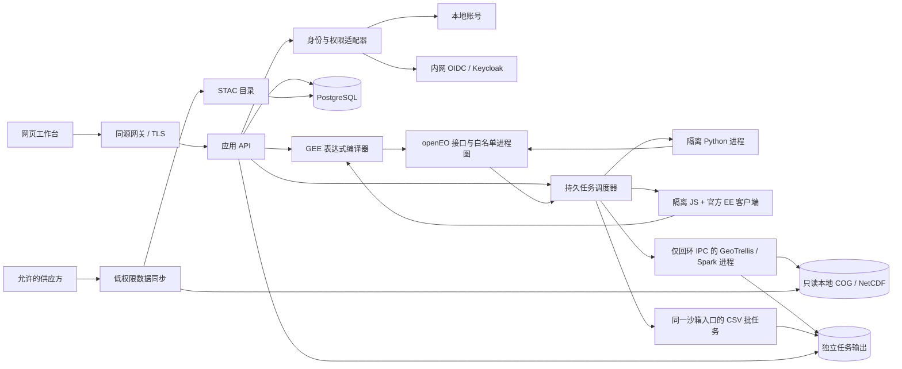

# 私有遥感工作台架构

状态：实施基线 v2，2026-10-21。当前运行配置改为 macOS 原生；旧容器验收仅属历史证据。面向个人科研和小团队，先在本机 macOS ARM64 验证，再具备向受控服务器部署的能力。本文规定目标边界和验收；不代表所有组件已完成或已通过生产验收。

## 1. 目标与约束

- 尽量保留常用 GEE JavaScript 项目的写法，通过官方客户端生成表达式，由本地兼容层转换为受控计算；Python 与 openEO 流程图继续可用。
- 数据、脚本、账号、结果和日志可在内网保存；已有数据支持离线检索、计算、预览和导出。构建及显式数据同步允许受控外网连接。
- 架构采用模块化单体控制面、独立沙箱进程及明确协议，不为模块化而把每个业务对象拆成微服务。计算、同步、身份服务保留独立部署边界。
- 先按 5 名用户、1 个重任务并行规划；脚本并发、资源、队列和磁盘预算由配置管理。吞吐能力通过测量决定。
- macOS ARM64 为当前执行平台；Linux 和 amd64 需要独立验收。原生 JNI/Java/Scala/GDAL 组合与文件摘要有清单。
- 无法承诺整个 GEE 全球数据目录、私有资产和所有服务端算法自动可用；不支持的请求明确失败，不伪造数据或静默忽略参数。

## 2. 组件与信任边界

浏览器只访问同源服务。调度器通过原生执行适配器创建独立 Seatbelt 进程，不接触 Docker 或虚拟机。脚本只持有绑定本次任务的短时令牌，只能读取运行库和自己的脚本、写自己的临时目录、连接回环 API 端口。批处理仅开放 Spark/Py4J 的回环通信，入库禁止全部网络；输入只读，输出限于本任务目录。可信分离的监督进程约束资源、收集有界日志并回收进程组，状态放在用户脚本不可访问的控制目录。

## 3. 模块与接口

前端固定为 **TypeScript + React**，使用 Vite 构建、CodeMirror 6 编辑代码、OpenLayers 渲染地图、React Flow 编辑 openEO 流程图。Motion 统一管理短动效并尊重系统减少动态效果设置；不引入外部资源。旧 Vue 工程已移出交付源码并保留在任务工作区备份。主工作台和流程图页均不加载 Vue。

| 模块 | 职责 | 禁止越界 |
| --- | --- | --- |
| `web/src/components/`, `hooks/`, `lib/` | 布局、编辑器、目录、地图、任务、管理与文档组件 | 不保存供应方密钥，不把自定义脚本放进有账号权限的浏览器上下文执行 |
| `gee/api/` | 版本化 HTTP 路由、认证、请求/响应校验 | 不直接实现科学算法或启动任意宿主进程 |
| `gee/services/` | 用例编排、配额、权限、任务与导出生命周期 | 不依赖浏览器状态，不绕过统一结果路径边界 |
| `gee/compat/earthengine/` | 规范 EE DAG 解码、元数据 IR、分组算子分派、图编译与能力清单 | 不执行输入函数文本，不联系 Google，不承诺语法存在即算法可用 |
| `runtimes/eejs/` | 官方 JS 客户端离线初始化、Map/Export/print 本地适配 | 不持有 DB/供应方凭据，不访问公网，不在 API 进程内执行用户代码 |
| `gee/graph.py` 与 openEO adapter | 严格校验规范进程图，冻结本地数据目录 | 不接受 URL/UDF/远程 namespace 或隐藏执行表示 |
| `gee/worker.py` / runtime registry | 排队、独立沙箱进程、限额、取消、恢复、结果发布 | 不信任脚本输出的路径、用户 ID、状态或资产清单 |
| `gee/artifacts.py` | 所有结果目录与文件的物理路径校验 | 不跟随符号链接，不允许跨任务路径或非普通文件 |
| `rf_validation_*`、`engine/ee_json_result.py`、`services/ee_runtime_results.py` | 真实 RF 要素预测、矩阵访问器及受任务权限保护的 JSON 结果 | 模型／矩阵仅连接规定消费者；JSON 不开放给通用图，结果与 CSV 共用物理文件边界 |
| `gee/table_values.py`、`table_geometry.py`、`table_graph.py` | 内联表格的 JSON／几何校验、CSV 编码、封闭的表格进程图及受信任写出 | 属性不能变成可执行节点；不访问 URL／路径，不混入栅格算子，不在 API 进程发布结果 |
| identity / access | 账号、OIDC 身份映射、角色、项目权限、会话与审计 | 不仅靠前端隐藏按钮，不信任未验证 JWT 或用户自报角色 |
| ingestion / catalog | 来源检查、标准化、质量控制、STAC、版本与处理记录 | 不写任务目录，不使用数据库管理员账号，不擅自新增出站地址 |
| administration | 用户/角色、任务与配额、数据源、系统状态、审计查询 | 不把凭据显示在页面或日志中，不允许普通用户授予自己权限 |

渐进拆分：已有 `app.py/backend.py/worker.py/auth.py` 暂作为兼容入口；新业务通过模块接口接入。EE 兼容实现已集中在 `gee/compat/earthengine/`；`gee/ee_translate.py` 保留为 23 行向后兼容导入 facade，供既有调用方使用。继续保留旧导入与 HTTP 合同，不得在同一次改动中无验证地重写全部路由。

内联要素 CSV 使用 `local_ee_table` 输入直连 `save_result(CSV)` 的两节点图，保留现有创建／排队／取消／恢复、脚本父任务权限、去重与文件发布合同。`engine/native_run.py` 在同一受限批任务入口处理该封闭图，实际写出 CSV 后返回，不初始化 Spark/JVM；普通栅格仍交给 GeoTrellis。此分支不是新的执行／隔离适配器，也没有无沙箱回退。数据中的 `process_id`、`from_node` 和 `process_graph` 等属性只是字面值，不参与目录依赖扫描或图物化。可信合成集成可验证应用路径，实际部署、内核隔离和浏览器验收另行记录。

影像取样另走 `local_ee_sample_regions → local_ee_train_minimum_distance → local_ee_minimum_distance` 的类型化计算图。采样／训练规格通过规范 JSON 字符串传递，避免要素属性成为流程指令；采样表和模型引用限定生产者。固定训练影像由独立子图保留来源和网格，不受目标导出范围污染；训练输入与输出像元分别计费。dry-run 只携带 schema／traces，真实样本表复用上游 SaveResult 和既有任务物理输出／CSV／权限边界。此链路不放宽沙箱，不改变纯内联表格的封闭执行分支；支持和证据边界见 [取样文档](gee-python/sampling.md)。

标签准备使用单波段 `local_ee_remap`，保留真实 Float32／Float64 输入精度及掩膜；采样后可插入最多 16 个 `local_ee_sample_table_op` 处理筛选／无排序限量。筛选器由受限 parser 生成既有 Filter IR，不执行用户文本。表操作只追溯到原 sampler，保留 schema／ID／顺序，复制前预充资源并把工作计数传给训练器；新列、排序、动态值／验证矩阵另需结果合同。Smile 随机森林不得用 Spark MLlib 替代注册，依赖与算法状态单列在路线文档。

随机森林新增独立 Smile1.5.3 模型 IR、可信串行 JVM 工厂和 GeoTrellis SPI；内联行与真实采样表分别经 `local_ee_train_smile_rf_rows`／`local_ee_train_smile_rf_samples`，opaque 模型仅可连接经过审查的栅格／要素预测或训练重代入矩阵消费者。嵌套引用也受类型检查，回调保持独立作用域，向量／标量结果不能冒充目标栅格。固定训练来源／网格与目标输出分离。依赖在独立 lock／manifest 中校验，复用固定 Spark SLF4J，不运行时下载；现有 native runner 通过本地 extraClassPath 接入，未安装不会自动获得该能力。RF 按实测分开计量对象复制（150000，含原操作最多50000）和 wire 扫描（3MB），原 compiler／表操作／minimumDistance 预算不变；树拟合及按真实树深的预测另有各10亿工作上界。详见 [RF 语法与执行合同](gee-python/random-forest.md)。本机部署与完整运行验收仍单独记录。

RF 要素分类与矩阵计算保留独立运行时 IR 和生产者合同。真实模型预测原始要素与保留的训练行，训练矩阵为重代入；矩阵仅进入七种明确访问器，JSON sink 只接受实际分类表／指标值。结果通过现有任务、父脚本权限及物理文件边界写出、复核和发布，worker 不收集其他任务的 JSON。纯内联 CSV 两节点分支保持封闭。同一个根作用域取样 IR 可复用训练分支，mapped 环境不缓存，原始输入及训练网格不改变；空样本不生成假行，未定义指标明确失败。详见 [要素验证语法](gee-python/rf-validation.md)。

文件规模按职责评审：多数业务模块约 150–250 行，接近 300 行时检查是否混合职责，超过 400 行通常先拆分再扩展。行数不是硬限制，不压缩代码、不把完整算法切成难以追踪的碎片；生成数据和固定上游源码不机械拆分。前端控制器负责状态和副作用，面板负责渲染，通过显式类型接口连接。

| 已拆分目录 | 职责 |
| --- | --- |
| `web/src/workbench/` | 文档与语言草稿、任务与日志生命周期，以及资源、编辑、输出和布局组件 |
| `web/src/components/map/` | 地图创建与销毁、研究区交互、栅格图层、显示参数及工具栏 |
| `web/src/components/graph/` | 进程节点、连线与布局、参数、导入导出控件 |
| `web/src/admin/panels/` | 资源页、行视图、记录表单及字段；管理外壳保留身份与 Refine 配置 |
| `web/src/admin/files/` | 文件轮询、上传校验与续传、入库生命周期及对应视图 |
| `scripts/ee_inventory/` | 离线兼容性清单的源码声明读取、证据白名单提取、隐私校验与报告组装；原 CLI 保留调用入口 |

### 3.1 EE 编译器模块边界

兼容编译器按职责拆分，避免重新积累到单一 translator 文件：

| 模块 | 职责 |
| --- | --- |
| `decoder.py`, `catalog.py`, `filtering.py` | 解码官方客户端 DAG、绑定本地目录元数据、构建筛选器并按本地元数据求值 |
| `dispatch.py`, `value_ops.py`, `image_ops.py`, `collection_ops.py`, `metadata_ops.py` | 将已解码调用分派到静态值、影像、集合与属性操作实现 |
| `ir.py`, `static_values.py`, `date_values.py` | 纯值类型和像素 IR、标量静态调用，以及 UTC 日期值辅助函数 |
| `number_math.py` | 有限静态正余弦、稳定范数与方向角，先校验／计费再运行 Float64 内核；显式记录 pinned SDK 轴约定和未做 Google 对照的数值政策 |
| `array_core.py`, `array_values.py`, `array_layout.py`, `array_arithmetic.py`, `array_reductions.py`, `array_matrix_extra.py` | 有限静态数组类型、形状／资源校验及分组数值内核 |
| `array_decompositions.py` | 静态方阵 QR／LU／SVD 的真实分解、有限输出与立方工作预充；通过既有 typed Array／Dictionary 接口组合，不另建前端计算层 |
| `array_argmax.py` | 有限静态数组与固定 Float32 栅格数组的首个行主序最大值坐标；静态路径保留原数值类型比较，栅格路径生成真实比较／条件坐标并保留整体掩膜，扫描及构图前预充预算 |
| `raster_array_core.py`, `raster_array_values.py`, `raster_array_layout.py`, `raster_array_coordinates.py`, `raster_array_reductions.py`, `raster_array_dispatch.py` | 单数组波段固定形状 IR、整体掩膜、常量坐标与分组操作；降为既有标量像素图，公开输出前必须转换为标量波段 |
| `raster_matrix_solve.py` | 静态满列秩设计的有限栅格最小二乘；双方显式 Float32、预充工作预算、常量 cast 链按对象缓存，输出真实像素乘加及整体掩膜，不宣称通用动态矩阵或 Google 数值等价 |
| `raster_collection_arrays.py`, `raster_array_reshape.py` | 有限标量集合按波段堆叠定长数组，各波段独立合并所有帧掩膜；常量有效长度向量重解释行主序形状，保留像素、类型和来源，拒绝变长数组及动态／掩膜形状 |
| `raster_array_concatenation.py` | 单数组按现有轴实际拼接／整块重复，固定行主序单元保持类型，拼接合并整体掩膜；重复次数必须由有效常量标量 Image 证明，动态／掩膜／空间限定次数拒绝，保留形状、工作及图预算 |
| `raster_array_accumulation.py` | 固定轴上的真实 Float32 前缀 sum／min／max，包含当前位置并保持原行主序及完整数组掩膜；省略 reducer 默认 sum，输出前计费，拒绝未实现 reducer／修饰符 |
| `raster_matrix_properties.py` | 固定二维数组提取对角列、构建对角矩阵及计算标量迹／小矩阵行列式／缩放 Frobenius 范数；保留完整输入掩膜与来源，算术显式逐步 Float32 舍入，预充构造工作且保留图预算，数值稳定性不冒称 Google 等价 |
| `raster_array_bands.py`, `raster_regression_frames.py`, `raster_linear_regression.py` | 有限多数组逻辑波段及选择／元数据；共用观测身份／输入顺序校验；过原点或单位截距回归与多响应 RMS 分开于表格路径，保留共同完整行掩膜及图预算 |
| `list_layout.py`, `list_reductions.py` | 静态 List 配对／展开／置换与有界归约；保留类型化原子值，单输出值与多输出回归字典各按实际合同返回 |
| `table_reducers.py`, `raster_linear_fit.py` | 共用回归规格；List 与内联表格复用数值内核，和有限帧逐像元 linearFit 分开适配，保留各自缺测、类型、规模和数值验证边界 |
| `confusion_values.py`, `feature_error_matrix.py` | 有界静态混淆矩阵、精确整数计数与总体指标；内联标签表显式顺序计数；内部矩阵类型不伪装成公开服务器对象 JSON，不代替采样或分类器 |
| `minimum_distance.py`, `classifier_features.py` | 有限静态类均值模型、欧式唯一最近类预测、要素分类及真实训练重代入误差；模型不可变，等距、未支持模式及直接对象 JSON 明确拒绝，与图像／随机森林执行分开 |
| `graph.py`, `pixel_graph.py`, `band_labels.py`, `temporal_graph.py`, `mask_graph.py` | 规范进程图组装、像素表达式编译、单波段标签延迟物化、保留观测身份的时间归约与原生掩膜处理；仅折叠相邻待生成元数据，不跨越数值／掩膜／类型转换边界 |
| `compile.py`, `capabilities.py` | 稳定的编译入口、已声明处理器清单与当前限制 |

模块通常以约 200 行为可维护性参考，不是硬性上限。按职责拆分，保持类型、验证和错误路径清晰；不得为满足行数而压缩代码或机械拆文件。编译器模块之间使用规范 `gee.compat.earthengine` 导入，不从 `gee.ee_translate` facade 回导形成循环；兼容期仍在根目录的辅助依赖要保持无环，并在合适的重构中迁入规范子包。拆分或新增 handler 不等于算法语义已经实现；每项公开能力仍需对应的参数、类型、边界及数值证据。

### 3.2 公共协议

- `/workbench/*`：当前网页会话与业务接口；保持既有脚本/任务/结果 URL 可用。
- `/openeo/1.2/*`：标准数据集、算子、作业、日志、结果接口，仅公布经支持清单确认的能力。
- `/gee/v1/*`：本地 EE dispatch、能力与结果适配，使用同一账号体系；脚本令牌仅访问声明的运行 API。
- 管理 API 使用独立 namespace 与服务端角色检查。错误返回稳定 `code/message/details`；敏感异常记录在本地脱敏日志中。
- 扩展参数使用明确命名，例如 `_gee_item_ids` 仅允许已有快照内的 item ID；在物化阶段转换为固定本地 STAC，不转发未知参数到上游 evaluator。

## 4. GEE 客户端兼容

### 4.1 官方客户端与执行

固定并保留 Apache-2.0 官方 `@google/earthengine` 客户端、许可证和校验值。使用其独立浏览器构建产物与公开算法签名离线构造对象和序列化图，不引入 Google OAuth、服务账号或公网计算。算法签名表只表示客户端可构造的调用，不代表本地实现了相同数量的算法。

JavaScript 使用固定官方客户端，在单独 Node + Seatbelt 进程执行；Python 用户可选用固定官方 `earthengine-api`，在单独 Python + Seatbelt 进程执行。两种客户端都只在本地构造对象和序列化表达式，调用 `/gee/v1/dispatch`，共享同一检查、编译、任务、数据目录和 GeoTrellis 后端。Python 客户端初始化绕过 Google 凭据发现、OAuth 和公网算法发现；`ee.Authenticate()` 与未适配的 Google 服务端点不可用于本地脚本。

EE Python 与现有 openEO Python 共用一个脚本运行器，但 API 含义不同：`ee` 提供官方 EE 对象模型，`connection` 保留 openEO 客户端。两者都由本地管理员会话派生短时脚本令牌，不向脚本暴露数据库、用户凭据或供应方密钥。工作台额外注入的 Python `Map` 是本地 UI 适配器，不属于官方 EE Python 包。只有经本地 dispatcher 实际实现的调用可运行；官方 SDK 的存在不代表云端 API 都有离线实现。

官方对象转换为受检查的 legacy EE DAG（CompoundValue、ValueRef、Invocation、Function、ArgumentRef）；解析器严格检查引用、循环、深度和大小。Function 只作为受控计算表达式编译，不在服务端当作代码执行。

本地编译器的规范实现位于 `gee/compat/earthengine/`，包含 decoder/catalog/filtering、分组 dispatch、IR/static/date、graph/pixel/temporal 编译、compile 入口及 capabilities。`gee/ee_translate.py` 仅作为旧导入的兼容 facade；新增实现和内部依赖留在规范子包中。

`Image.classify` 的有限 minimumDistance 模型沿现有 IR／批任务链路进入 `local_ee_minimum_distance`，不通过 Float32 通用 callback 猜测分类。编译器按训练 schema 名称选择并排列真实输入波段，将精确类中心编码为版本化分数字符串；API 图校验、受信任 Python 桥与 Scala 模型解析分别检查合同。GeoTrellis tile 内核按输入 binary64 位恢复有理数并排名，输出单个 Int32 NoData `v` 波段，再由编译器恢复 SDK 输出名。沿用既有网格／时间／物理结果边界和沙箱，不新增执行或隔离回退。可信独立 tile 内核验证不等于完整 Spark cube、生产任务、浏览器或 Google 同数据验收。

### 4.2 分层验收

| 等级 | 含义 | 所需证据 |
| --- | --- | --- |
| S：语法 | 官方客户端可构造/序列化调用 | 固定 SDK 的实际脚本探针 |
| C：编译 | 调用完整转换为本地白名单进程图 | 正反向参数、类型与协议测试 |
| E：引擎执行 | 目标平台实际运行计算引擎 | 明确运行平台、版本和任务结果；静态编译器求值单独记录 |
| N：数值 | 实际结果符合独立参考及约定的掩膜/网格/单位 | 闭式静态参考、多景合成夹具、真实样本；注明是否经过栅格引擎 |
| G：GEE 对照 | 与指定原始 GEE 任务及相同数据对照 | 保存输入、版本、网格和误差报告 |

页面和文档不能把 S/C 标成 E/N/G。静态数值验证不等于原生栅格引擎执行。无法访问 GEE 或没有完全相同数据时，G 保持未验证。

首要覆盖：Image/ImageCollection/Geometry、Filter、常用 Reducer、日期与空间/属性筛选、select/rename、map 内逐像素计算、算术/比较/逻辑、normalizedDifference/expression、二值 updateMask、addBands、clip、常用时间归约、有序 mosaic、地图显示与本地影像/表格导出。按能力清单记录具体参数与限制，不以一句“主流兼容”代替清单。

### 4.3 不可丢失的语义

- `filterDate` 是毫秒精度 `[start,end)`；`filterBounds` 选相交影像，`clip` 才掩膜影像。不能混用。
- 集合保留明确顺序；median 与 mosaic 不可互相替代。无法表达的排序/重复时间点需报错或实现明确的逐景策略。
- `normalizedDifference` 对负输入的掩膜、输出 band 名和属性规则与普通表达式不同。
- GEE updateMask 的有效值方向与 openEO mask 相反；分数 mask/边界像元权重必须单独实现和验证。
- select 的数字/名称/正则与重命名保留顺序；addBands 的重名与 overwrite 行为必须明确。
- `Map.addLayer` 使用真实任务结果；RGB、色带、min/max、gamma、opacity 只接受已实现参数，不能把 RGB 当第一波段伪彩色。
- `Export.*.toDrive` 适配为本地任务与下载，页面标明目的地为本地，不声称已上传 Google Drive。导出 region/scale/CRS/NoData 必须参与实际处理。
- 动态 getInfo/evaluate 是受控查询或有限等待任务，不能假定所有 EE 对象都是立即本地值。

### 4.4 数据兼容

数据别名记录源数据、波段映射、尺度、缺失波段、覆盖范围、预处理与兼容等级。当前本地 Sentinel-2 已预去云、只有有限波段；给它一个 GEE 数据集别名不会恢复被删掉的像素，也不等于完整镜像该数据集。DN view 必须显式转换并有数值测试。缺少 QA60/B11 等时报缺失，不伪造质量位或静默替代。

## 5. 身份、权限与管理

首版保留本地账号，生产方向采用标准 OIDC 接口，可接内网 Keycloak。OIDC 通过标准授权码流程与 PKCE/服务端会话接入，验证 issuer、audience、state、nonce 和签名；登录页面、令牌、登出与账号映射分离。无需 Google 或其他公网登录。

用户身份以稳定内部 ID 表示，外部身份通过 `(issuer, subject)` 唯一映射，不用可变邮箱或显示名做所有权键。本地账号与既有脚本/结果按原 ID 保留。角色分为管理员、数据管理员、研究员、只读成员；项目成员与共享权限是独立关系。数据管理员不因此获得用户管理权。管理员创建/禁用账号、调整角色和配额；越权由 API 拒绝。普通用户不能修改自己角色。

应用会话使用 HttpOnly/SameSite cookie，生产必须 HTTPS；cookie 变更请求检查来源并有 CSRF 防护。认证尝试使用跨 worker 的原子限流；短时脚本 token 绑定用户、作用域和任务，结束后撤销。UI 不显示密码、JWT、密钥或完整敏感环境变量。

管理界面分用户权限、任务队列、数据源、配额与系统审计；各页只查询后端授权后的信息。不可因“管理员页面未显示”而省略 API 权限控制。

管理组件选型采用 Keycloak + Refine Core + 本平台业务 API，目录预留 STAC/PgSTAC 适配器。完整取舍、管理员添加数据集的校验与发布流程、账号迁移及组件验收边界见 [管理与认证组件选型](admin-components.md)。GeoNode 作为完整 GIS 门户备选，当前不并行引入第二套门户。Refine 遥测显式关闭；现有目录在独立 PgSTAC 迁移验收前继续保留。

文件是独立业务模块：管理 API 接收有大小预算和 SHA-256 的分块，仅写专用暂存挂载；无凭据、无网络的入库进程读取单个原文件，生成标准化 COG 与校验报告，由可信发布服务登记 STAC。目录草稿、已存储原件、已入库影像和已发布数据集分别表达。文件列表、续传、下载与当前格式范围见 [数据集与文件管理](dataset-files.md)。

## 6. 数据与持久任务

PostgreSQL 保存身份/角色/项目、脚本及语言、任务状态、父子任务关系、输入快照、导出配置、图层意图、审计记录。COG/NetCDF 和大结果放本地资产存储，不写成数据库大对象。STAC 保留版本、来源、单位、NoData、坐标系、校验和与处理记录。

状态机：created → queued → running → finished/error/canceled；终态只读，重提产生新任务 ID。GEE 的 Map/Export 子任务关联脚本父任务；脚本退出不伪造子任务成功。导出创建与启动分别表达。任务服务通过事务锁/幂等键约束配额和重复提交，队列可从持久状态恢复。

版本化数据库迁移逐步替代运行期 DDL：installer/migrator 执行 schema 变更，API/worker/sync 使用各自有限角色。迁移前备份，采用兼容的增量字段，验证旧账号、私有脚本与已完成结果仍可访问。

## 7. 部署、资源与运维

开发/本机：macOS 原生 PostgreSQL、Gunicorn 同源静态/API 服务、原生任务调度器与 Seatbelt 子进程；按需启动，退出即停止全部本项目服务。生产：受控主机、TLS、独立权限、容量与备份须重新验收。生产 profile 与开发配置分离，不暴露 DB、Docker API、Spark UI 或调试端点。OIDC、监控、管理组件可独立开启，默认不产生公网统计或错误上报。

- 分别限制脚本、重任务和同步的 CPU、内存、swap、PIDs、运行时长和临时空间。已有单来源字节预算和低水位不等于完整用户磁盘硬配额，后者作为独立生产要求验收。
- 本地日志记录任务 ID、用户内部 ID、状态变化和管理操作，令牌/密码脱敏；不记录默认完整脚本正文或数据结果作为遥测标签。
- 健康/readiness、队列延迟、执行失败、剩余存储和资源指标提供给内网接收端。监控界面采用现成组件时仍限制来源与采集字段。
- 依赖锁、SBOM、镜像扫描和漏洞处置随构建产物保存。无补丁项保留风险、可达性、补偿控制和后续处置，不删除元数据隐藏告警。
- 备份必须包含数据库、数据目录、当前镜像锁及必要部署配置，权限0600；恢复到独立实例核对所有权、文件校验和与小任务。数据库 glibc collation 升级按停机/重索引/刷新流程操作，不直接降级已有卷。

## 8. 实施顺序与完成条件

| 阶段 | 交付 | 完成条件 |
| --- | --- | --- |
| P0 架构与基线 | 本文、AGENTS、版本和现有证据 | 约束清晰，已有账号/数据保留 |
| P1 GEE JS 纵向链路 | 官方 SDK 离线初始化、独立运行器、编译器、Map/Export 本地任务 | 网页实际运行原生 GEE 风格脚本，地图/下载正常，独立数值对照通过 |
| P2 主流语义与界面 | 能力清单、多景/掩膜/表达式夹具、组件化工作台与文档 | 支持项逐项验收，未支持准确报错；常用桌面宽度代码/地图均可用 |
| P3 身份与管理 | provider 接口、本地权限、OIDC 自建 profile、管理页、版本化迁移 | 双用户/角色拒绝、会话与限流、OIDC 登录登出和权限验收 |
| P4 生产部署与运维 | TLS/profile、有限 DB 角色、配额/指标/审计、备份恢复与依赖处置 | 重启恢复、资源约束、离线/出站、独立恢复和部署文档匹配实物 |

每阶段报告为 implemented / verified / partial / blocked，并链接证据。阶段未完成时持续推进，不把“支持语法”“编译通过”或“候选镜像构建”当作部署验收。

## 9. 当前实施状态

- P0 revised：用户要求删除旧 VM、镜像和数据库，转为 macOS 原生。已有影像、结果和源码保留，旧账号/脚本/任务数据库不恢复；新本机数据库重新初始化。当前实现与证据见 `native-macos.md`。
- P1 verified：官方客户端 → 隔离 Node → 本地 EE 编译器 → openEO/GeoTrellis → 网页地图和下载已跑通。真实 Sentinel-2 单景 NDVI 与独立基准掩膜相同、最大绝对误差 0，见 `audit/react-ui/ndvi-validation.json`；非矩形导出见 `audit/ee-export-region/validation.json`。
- P2 partial：工作台与流程图已采用严格 TypeScript + React；CodeMirror/OpenLayers/React Flow/Motion、三种桌面宽度、减少动态效果均有实测。多景 23 项输出通过固定引擎及独立 NumPy 比较，见 `audit/ee-compat-wave2/validation.json`；具体语法与限制见 `docs/gee-compatibility.md`。没有原始 GEE 同数据对照，不标 G。
- P2 新增有限网格 `unmask`：默认 0、标量、对齐栅格替换、clip 保留及 Float64 精度已有 5 项 SDK→原生引擎独立数值验收；不同 footprint、相同时间戳的逐景填补后均值另有 1 项独立验收，掩膜差异与数值误差均为 0。独立 SPI 探针覆盖缺 tile、重复键、精度、空输入与预算拒绝。全局 footprint 扩展、隐式重投影/时间广播和 Float64 回调归约仍拒绝；未完成 Google 对照。汇总见 `reports/gee-mask-wave4.json`。
- 适配边界：增加 EE 入口，继续共用 openEO 数据、队列和引擎。当前逐景归约避开上游按日合并的语义差异，不改科研日期。复杂流程仍受 500 节点限制，后续优化不以牺牲逐景身份为代价。
- P3 partial：Refine 管理中心、本地四角色权限、用户停用/会话撤销、最后管理员保护、数据集草稿/发布/下架、任务查询/取消、管理审计和独立版本化迁移已实现。文件模块实现分块上传、校验、原件下载、GeoTIFF 隔离入库与 COG 下载；组件验证与运行证据分别在 `audit/admin-v1/`、`audit/admin-files-v1-r3/`、`audit/admin-files-live-v1/`。Keycloak OIDC、项目/数据集对象权限、非 GeoTIFF 通用入库仍待实施。
- P4 partial：已有隔离、持久任务、版本化 migrator 与迁移前备份可用；有限 DB 角色、TLS、完整磁盘硬配额、文件归档清理与完整生产 profile 尚待实施。依赖处置和端到端出站审查继续保留原验收要求。
- 既存风险：libxml2、内部 shaded Avro 及其他依赖告警仍按托管安全报告保留；本文不取消既有隔离或冒称依赖已修复。

## 10. 原生迁移说明

用户最新要求优先：禁止重新创建 VM 或容器，采用 macOS Unix 进程与内核沙箱。`gee/native/` 提供执行边界，`scripts/native.py` 提供显式启停，`engine/native_run.py` 适配本机 JVM/GDAL。旧 P1–P4 容器验证不自动证明原生版本；原生验收使用新的 `audit/native-macos-*` 目录。CPU 线程配置、rlimit 与 RSS 监督不等于 Linux cgroups；Seatbelt 依赖本机 macOS，不能把当前本机版本声称为互联网多租户生产隔离。
